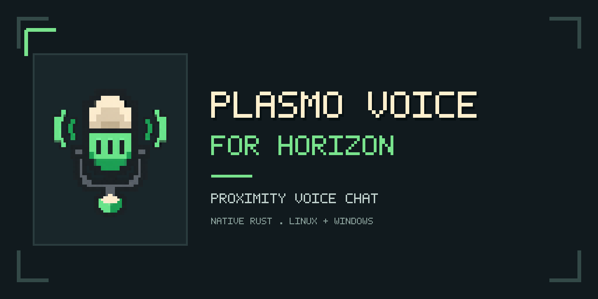
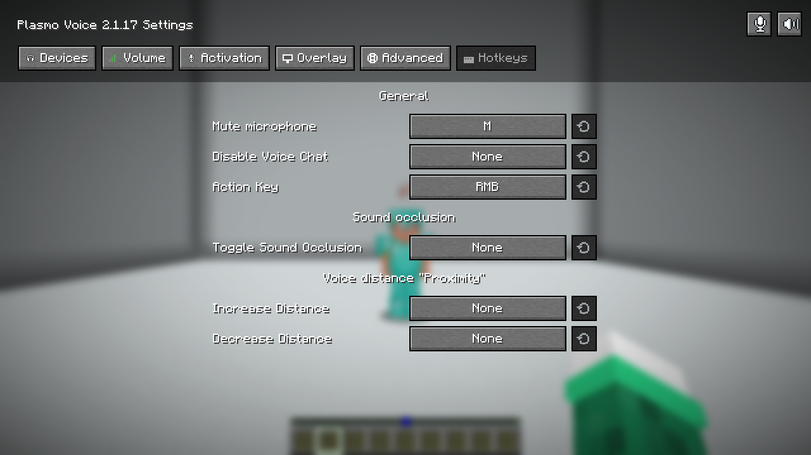

  

<h1 align="center">Plasmo Voice for Horizon</h1>

Proximity voice chat. Native Rust. Built for Horizon.

  <a href="LICENSE">MIT</a> ·
  <a href="NATIVE_INSTALL.md">Installation</a> ·
  <a href="VALIDATION.md">Tested behavior</a> ·
  <a href="docs/DEVELOPMENT.md">Development</a>

An **unofficial, independently written client** for servers running
[Plasmo Voice](https://github.com/plasmoapp/plasmo-voice) 2.1. Talk to nearby
players from Horizon, with positional sound, push to talk, and a familiar voice
settings menu. This is a native **`.hnmod`**, built into the client by Horizon
Launcher. It is written in Rust, not a Fabric or NeoForge JAR.

> **0.5.2 · Horizon native API 411 or newer**
> The Hooks/Host integration uses officially registered Horizon APIs. Download
> the `.hnmod` from [Releases](https://github.com/rison1337/horizon-plasmo-voice/releases).
> One package includes both Linux x86_64 and Windows x64 runtimes.
> The [Horizon catalog submission](https://github.com/horizon-rust/horizon-mods/pull/305)
> is pending review; publishing a release does not list it automatically.

## What you get

- **Proximity voice:** distance attenuation, stereo positioning, optional HRTF,
  directional sources, and sound occlusion.
- **Talk over menus:** PTT works while paused, in settings, inventory, chat, and
  the mod menu. Losing window focus clears the held key.
- **Clear indicators:** your microphone state stays above interfaces. Pixel
  icons follow other players' heads, account for helmets, and disappear behind
  obstructing blocks. Servers without Plasmo Voice do not show a connection icon.
- **Player controls:** individual volume and mute, source/channel levels, and
  Shift + RMB + mouse wheel adjustment. Player gain multiplies the proximity level.
- **Six settings tabs:** Devices, Volume, Activation, Overlay, Advanced, Hotkeys.
  Device selection, voice activation, key chords, microphone preview, and RNNoise.
- **One package:** Linux x86_64 and Windows x64 runtimes, including checked Opus,
  RNNoise, and OpenAL Soft libraries. English and Russian in-game translations.

## Controls

| Action | Default |
| --- | --- |
| Open voice settings | **V** |
| Push to talk | Hold **Left Alt** |
| Toggle microphone mute | **M** |
| Adjust the targeted player's volume | Hold **Shift + RMB** and scroll |

Bindings can be changed in **Hotkeys**. Existing saved bindings take precedence.
The local microphone preview is not sent to the server.
The player-volume indicator appears only after the volume actually changes;
holding RMB or Shift alone does not show it.

## Install

Put the `.hnmod` into your instance's `horizon-native-mods/`, enable
`plasmo_voice` on the launcher's **Mods** page, select **Performance**, and
**Build**. Then start the instance with **Play**. The post-build step installs
and verifies the libraries for the current operating system.

Use a Nightly with native API **411 or newer**. The release records the tested
public source commit; compatible newer Nightlies can build it too.
Source-build commands are in the [development guide](docs/DEVELOPMENT.md).
Full instructions and platform requirements are in [NATIVE_INSTALL.md](NATIVE_INSTALL.md).

**Minecraft version support belongs to Horizon.** For older servers supported
by Horizon, explicitly set `HORIZON_OLDER_SERVERS=1` in your instance's launch
**Environment variables**. The voice mod does not enable old protocols, replace
item decoders, or change that environment variable. Horizon itself uses resources
from Minecraft 26.3. See the [server compatibility checks](docs/SERVER_COMPATIBILITY.md)
for tested versions and the remaining upstream inventory limitation.

## In-game interface

Actual Horizon API-adapter screenshot from an isolated Linux LAN test.

## Compatibility and testing

The interoperability reference is released **Plasmo Voice 2.1.17 on Fabric
1.21.11**. Original Plasmo Voice implementation code and graphic assets were
not read or copied. This project is not affiliated with or endorsed by the
Plasmo Voice, Horizon, Mojang, or Microsoft teams.

Linux live checks include real two-way synthetic audio against Paper
**1.21.10, 1.21.11, 26.1.2, 26.2 and 26.3**, plus pause-menu PTT and chest/item
checks. An explicit horn instrument still fails in Horizon's two tested 1.21.x
adapters; see the [matrix and upstream fix](docs/SERVER_COMPATIBILITY.md).
Earlier checks cover PTT on eight screens, player volume, English UI, camera
alignment, helmet/crouch clearance, and block-shape visibility.
The engine has **22 engine tests** and the
adapter has **5 regression tests**. Windows x64 cross-checking passes; actual
Windows GUI and physical audio-device testing is still outstanding.

See [VALIDATION.md](VALIDATION.md) and [PARITY.md](PARITY.md) for the evidence and
limits. Pixel-for-pixel UI or bit-identical audio processing is not claimed.

## Source layout

| Path | Purpose |
| --- | --- |
| `native-api/` | Hooks/Host adapter, settings UI, original in-game pixel icons |
| `engine/` | Protocol, UDP/AES/Opus, device I/O, audio processing and spatial sound |
| `data/runtime/` | Both platforms' libraries, checksums, licenses and source archives |
| `tools/` | Development staging, packaging, and branding exports |
| `assets/` | Shared launcher/README icon and GitHub social preview artwork |
| `publishing/` | Catalog entry and icon submitted for review |

## License and credits

The original Rust implementation is [MIT](LICENSE). Third-party runtime
libraries retain their own licenses; notices and corresponding OpenAL source
archives are included. The protocol reference and all attributions are in
[THIRD_PARTY_NOTICES.md](THIRD_PARTY_NOTICES.md).

The [upstream Plasmo Voice project](https://github.com/plasmoapp/plasmo-voice)
provides the server and original Java client. This repository provides an
independent compatible Horizon client.
