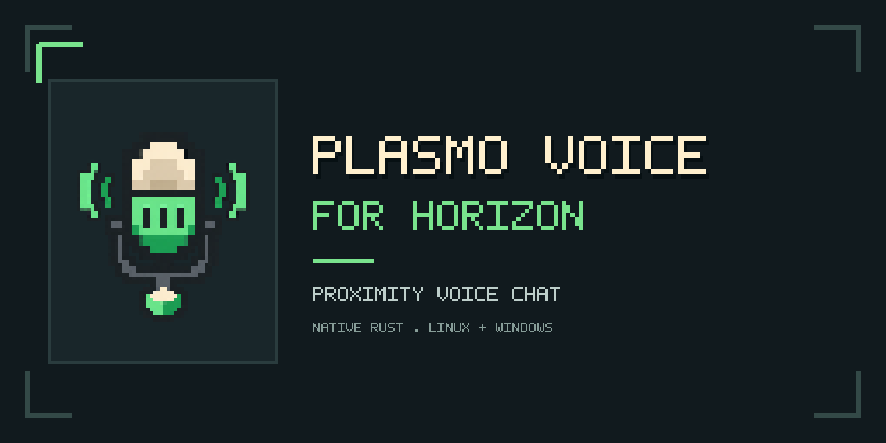

<p align="center"></p>
<h1 align="center">Plasmo Voice for Horizon</h1>
<p align="center">Proximity voice chat · Native Rust · Horizon SDK</p>



An unofficial, independently written Rust client for servers running
[Plasmo Voice](https://github.com/plasmoapp/plasmo-voice) 2.1.

**0.6.0 uses the current Horizon SDK and a single source-only `.hmod`.**
The launcher compiles the mod against the published game SDK. It does not rebuild
Horizon. Legacy `.hnmod` packages and native API 411 are no longer used.

[Download](https://github.com/rison1337/horizon-plasmo-voice/releases/tag/v0.6.0) ·
[Installation](NATIVE_INSTALL.md) · [Validation](VALIDATION.md) ·
[Development](docs/DEVELOPMENT.md) · [License](LICENSE)

## Features

- Proximity voice, distance attenuation, stereo positioning, optional HRTF,
  directional sources, occlusion and RNNoise suppression.
- Push to talk over pause, settings, inventory, chat and voice interfaces.
  A foreground microphone indicator distinguishes held PTT from transmission.
- Six settings tabs: Devices, Volume, Activation, Overlay, Advanced, Hotkeys.
  Microphone preview, device selection, voice activation and configurable bindings.
- Player volume and mute; individual gain multiplies source and master gain.
  Hold **Shift + RMB** and scroll while aiming at a player to adjust volume.
  The volume indicator appears only after a change.
- Pixel icons rendered with the player's current pose and the world's depth
  buffer: fixed world size, helmet clearance, no retained screen projection.
- Idle servers without a voice handshake show no connection animation.
- English and Russian. One source package for Linux x86_64 and Windows x64 GNU.

## Install

Use Horizon Launcher **0.2.85 or newer**, with the published
**2026-11-19 Nightly** (`f00125f61f794aaa3d4e950d301f353b35b6ee3d`).
The package pins that SDK and Mixins `e59da9094f0c2fdda6c627fe9eff22dec6a906f0`.
A future Nightly requires an SDK compatibility check; arbitrary newer builds
are not promised.

In the selected instance's Mods page, choose **Add from GitHub** and enter:

```text
https://github.com/rison1337/horizon-plasmo-voice/releases/tag/v0.6.0
```

Accept Horizon's native-code notice, build the instance's native mods, then Play.
Alternatively, place the downloaded `.hmod` in `horizon-native-mods/` and build
through the launcher. Keep one version enabled. Registry listing requires
maintainer review and is separate from publishing this GitHub release.

**First audio preparation needs C/C++, CMake and Linux ALSA development headers;
Windows GNU also needs Ninja.** Audio libraries compile offline in a background
worker from bundled, verified upstream source. Later starts reuse the instance's
cache. Missing tools leave voice disabled with a translated explanation; install
them and choose **Reconnect voice**. Restart the launcher if its PATH changed.
macOS and Windows MSVC voice are unsupported. See [installation](NATIVE_INSTALL.md).

## Controls

| Action | Default |
| --- | --- |
| Voice settings | **V** |
| Push to talk | Hold **Left Alt** |
| Microphone mute | **M** |
| Targeted player volume | Hold **Shift + RMB**, scroll |

Custom bindings saved in the mod's Hotkeys tab take precedence. Local microphone
preview is not transmitted. Server compatibility follows Horizon's Minecraft
protocol adapters; the voice mod does not patch inventory or enable old protocols.

## Testing and limits

0.6.0 passes an actual optimized launcher build against the exact signed SDK,
engine/adapter regressions, independent OpenSSL key-exchange interoperability,
source-built DSP and OpenAL null-output checks. Linux game/menu checks use isolated
player data. CI covers Linux and Windows audio source builds and unsupported macOS.

The five-server audio matrix belongs to **0.5.0**, before this SDK migration.
A new two-client Paper 1.21.11 / Plasmo Voice 2.1.17 test verifies audio in both
directions through explicitly selected virtual input/output devices, PTT over
interfaces, persisted bindings, player volume and wall occlusion. Windows GUI
and physical audio-device tests are not claimed for 0.6.0. See [VALIDATION.md](VALIDATION.md) for precise evidence;
[PARITY.md](PARITY.md) describes existing feature limits.

## Source

| Path | Purpose |
| --- | --- |
| `mod/` | Complete flat SDK project and packaged resources |
| `mod/src/voice/` | Protocol, encryption, UDP, audio, source preparation |
| `mod/src/sdk.rs` | Public ClientHost/Hooks bridge and entity rendering |
| `mod/assets/plasmo_voice/audio/` | Unmodified source archives, hashes, licenses, CMake recipe |
| `engine/` | Development test harness using the same voice source |
| `tools/` | SDK tests, registry lock resolution and packaging |
| `branding/` | Original project artwork |

The original Rust code and artwork are MIT. Opus, RNNoise and OpenAL Soft retain
their own licenses and complete corresponding sources. See
[THIRD_PARTY_NOTICES.md](THIRD_PARTY_NOTICES.md). Original Plasmo Voice implementation
sources and graphics were not copied. This project is not affiliated with Plasmo
Voice, Horizon, Mojang or Microsoft.
